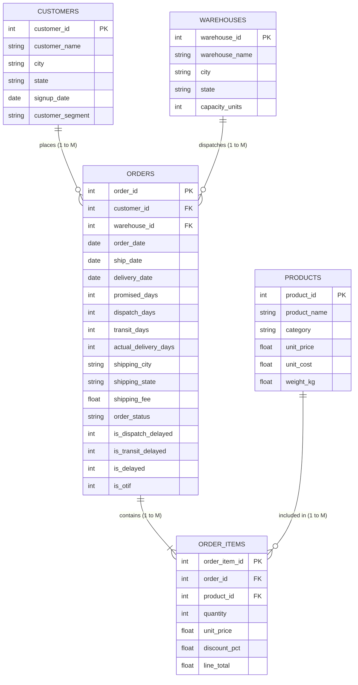

# 📊 Relational Star Schema & Data Dictionary
## Enterprise E-Commerce & Supply Chain Logistics Lakehouse (Big Data Analyst Edition)

---

## 1. Entity-Relationship Diagram (Star Schema)

---

## 2. Table-by-Table Data Dictionary

### Dimension 1: `customers` (50,000 Rows)
* **`customer_id`** (`INTEGER`, **Primary Key**): Unique customer identifier (`50001` to `100000`).
* **`customer_name`** (`STRING`): Anonymized customer label (e.g., `Customer_50001`).
* **`city`** (`STRING`): Resident city (New York, Los Angeles, Chicago, Houston, Miami, etc.).
* **`state`** (`STRING`): 2-letter state code (`NY`, `CA`, `TX`, `FL`, `IL`, etc.).
* **`signup_date`** (`DATE`): Account registration date (2021-01-01 to 2023-12-31).
* **`customer_segment`** (`STRING`): Customer tier (`Consumer`, `Corporate`, `Small Business`). *Contains injected typos (`Consumr`, `Corp`) for PySpark cleaning.*

---

### Dimension 2: `products` (1,000 Rows)
* **`product_id`** (`INTEGER`, **Primary Key**): Unique catalog SKU (`1001` to `2000`).
* **`product_name`** (`STRING`): Product description.
* **`category`** (`STRING`): 6 major categories (`Electronics`, `Home & Kitchen`, `Apparel`, `Books`, `Sports & Outdoors`, `Beauty & Health`).
* **`unit_price`** (`FLOAT`): Retail price to customer ($8.00 to $1,200.00).
* **`unit_cost`** (`FLOAT`): Procurement / supplier cost (30% to 65% profit margins).
* **`weight_kg`** (`FLOAT`): Physical weight in kilograms (influences freight transit time and ML prediction).

---

### Dimension 3: `warehouses` (10 Rows)
* **`warehouse_id`** (`INTEGER`, **Primary Key**): Distribution hub ID (`1` to `10`).
* **`warehouse_name`** (`STRING`): Hub title (e.g., `East Coast Hub`, `Midwest Logistics Center`).
* **`city` / `state`** (`STRING`): Geographical origin hub.
* **`capacity_units`** (`INTEGER`): Storage capacity volume (300,000 to 800,000 units).

---

### Fact Table 1: `orders` (Order Header - 1,000,000 Rows, Chunked into 4 CSVs)
Grain: **1 row per customer order transaction.**
* **`order_id`** (`INTEGER`, **Primary Key**): Primary transaction identifier. *Bronze contains 1% duplicate keys (10,000 exact clones); deduplicated in Silver.*
* **`customer_id`** (`INTEGER`, **Foreign Key**): References `customers.customer_id`.
* **`warehouse_id`** (`INTEGER`, **Foreign Key**): References `warehouses.warehouse_id`.
* **`order_date`** (`DATE`): Purchase timestamp (2022-01-01 to 2024-06-29, 911 continuous days).
* **`ship_date`** (`DATE`): Date dispatched from warehouse (NULL for cancelled orders).
* **`delivery_date`** (`DATE`): Date delivered to customer door (NULL for cancelled orders).
* **`promised_days`** (`INTEGER`): Guaranteed delivery SLA window (2 to 7 days).
* **`dispatch_days`** (`INTEGER`): Lead time from order to dispatch (`ship_date - order_date`).
* **`transit_days`** (`INTEGER`): Lead time from dispatch to delivery (`delivery_date - ship_date`).
* **`actual_delivery_days`** (`INTEGER`): Total fulfillment days (`dispatch_days + transit_days`).
* **`shipping_city`** (`STRING`): **Snapshot Shipping Address Grain** — Captured point-in-time delivery city. Decouples transaction history from moving customers.
* **`shipping_state`** (`STRING`): **Snapshot Shipping Address Grain** — Captured point-in-time delivery state.
* **`shipping_fee`** (`FLOAT`): Order-level freight fee ($0.00, $4.99, $9.99, $14.99).
* **`order_status`** (`STRING`): Fulfillment state (`Completed`, `Cancelled`, `Returned`).
* **`is_dispatch_delayed`** (`INTEGER`): 1 if `dispatch_days > 2` (warehouse packing bottleneck), else 0.
* **`is_transit_delayed`** (`INTEGER`): 1 if `transit_days > (promised_days - 2)` (carrier highway bottleneck), else 0.
* **`is_delayed`** (`INTEGER`, **Primary ML Target**): 1 if late (`actual > promised`), 0 if on-time, **NULL if Cancelled** (prevents diluting corporate delay rate).
* **`is_on_time_delivery`** (`INTEGER`, **Carrier Logistics SLA**): 1 if physically delivered $\le \text{promised\_days}$ (evaluates Carrier performance on `Completed` and `Returned`).
* **`is_otif`** (`INTEGER`, **Commercial Supply Chain KPI**): 1 if `is_delayed == 0` and `order_status == 'Completed'` (On-Time In-Full order retention).
* **`delay_attribution`** (`STRING`, **Root-Cause Classification**): `'None'`, `'Warehouse Only'`, `'Carrier Only'`, `'Compound (Both)'`.
* **`is_guest_checkout`** (`INTEGER`): 1 if `order_date < signup_date` (retroactively linked account), else 0.
* **`customer_tenure_days`** (`INTEGER`): Days since signup at time of purchase, floored at 0: `greatest(datediff(order_date, signup_date), 0)`.
* **`order_year_month`** (`STRING`): `YYYY-MM` partition key for high-performance Delta queries.

---

### Fact Table 2: `order_items` (Order Line Items - ~1,500,000 Rows, Chunked into 4 CSVs)
Grain: **1 row per individual product line item in an order.**
* **`order_item_id`** (`INTEGER`, **Primary Key**): Unique item row ID.
* **`order_id`** (`INTEGER`, **Foreign Key**): References `orders.order_id`.
* **`product_id`** (`INTEGER`, **Foreign Key**): References `products.product_id`.
* **`quantity`** (`INTEGER`): Quantity purchased (1 to 5 units).
* **`unit_price`** (`FLOAT`): Price at time of purchase.
* **`discount_pct`** (`FLOAT`): Promotional discount applied (0.00 to 0.20).
* **`line_total`** (`FLOAT`): Net line item revenue: `ROUND(quantity * unit_price * (1.0 - discount_pct), 2)`.
