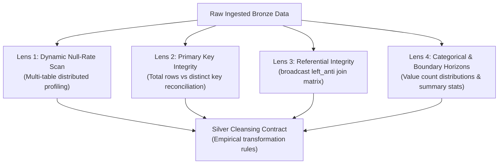

# 📋 Data Quality Audit Report: Bronze Lakehouse Ingestion
## Enterprise E-Commerce & Supply Chain Logistics Lakehouse (Big Data Analyst Edition)

---

## 1. Executive Summary & Audit Scope

* **Target Storage Layer:** Bronze Delta Lake (`workspace.default.bronze_*`)
* **Execution Engine:** Databricks Runtime (Apache Spark 3.x / Unity Catalog)
* **Dataset Volume Audited:**
  * **Fact Transactions:** 1,010,000 Order Headers (`bronze_orders`)
  * **Fact Line Items:** 1,464,019 Order Items (`bronze_order_items`)
  * **Master Dimensions:** 50,000 Customers, 1,000 Products, 10 Distribution Hubs
* **Audit Objective:** Systematically profile the raw Bronze data using a 4-lens exploratory inspection framework to identify data quality gaps, quantify duplication, discover categorical anomalies, and verify referential integrity prior to Silver curation.

---

## 2. Audit Methodology: The 4 Inspection Lenses

Rather than assuming data cleanliness or relying on hardcoded heuristics, the Bronze layer was audited through four systematic lenses:



1. **Lens 1 (Dynamic Null-Rate Profiler):** Programmatic list comprehension aggregating null counts and percentages across all table columns in a single distributed pass.
2. **Lens 2 (Primary Key Integrity & Uniqueness):** Quantitative comparison between total physical row counts and distinct primary key counts.
3. **Lens 3 (Referential Integrity via `left_anti` Joins):** Catalyst-optimized anti-joins with `broadcast()` hints testing foreign key linkage across all 4 relational dimensions.
4. **Lens 4 (Categorical Frequency & Boundary Scanning):** Cardinality checks, categorical frequency distributions, and five-number summary profiling (`min`, `25%`, `median`, `75%`, `max`).

---

## 3. Empirical Audit Findings by Table

### Table 1: `bronze_orders` (Fact Header - Module A)
* **Total Records Ingested:** 1,010,000
* **Distinct `order_id` (Primary Key Cardinality):** 1,000,000
* **Empirical Audit Findings:**
  1. **Primary Key Duplication (Step A2):**
     * **Duplicate Count:** Exactly **10,000 duplicate rows (0.99%)**.
     * **Unique Keys Affected:** Exactly **10,000 distinct `order_id`s** appear with a frequency count of 2.
     * **Duplicate Anatomy:** Detailed inspection of sample `order_id: 10500196` revealed that duplicated records are **exact row clones** across all operational attributes (`customer_id`, `warehouse_id`, `order_date`, `ship_date`, `delivery_date`, `promised_days`, `dispatch_days`, etc.).
     * **Root Cause & Impact:** Caused by at-least-once ingestion re-transmissions. If not deduplicated prior to Silver, aggregate GMV, revenue, and order volume metrics will be inflated by ~1%.
  2. **Coordinated Null Pattern & Missingness Mechanism (Step A1):**
     * **Milestone Null Rate:** Exactly **81,031 rows (8.0228%)** contain null values across 5 milestone attributes (`ship_date`, `delivery_date`, `dispatch_days`, `transit_days`, `actual_delivery_days`).
     * **Field Completeness:** Zero nulls (0.00%) across all other 15 attributes (`order_id`, `customer_id`, `warehouse_id`, `order_date`, `promised_days`, `shipping_city`, `shipping_state`, `shipping_fee`, `order_status`, `is_dispatch_delayed`, `is_transit_delayed`, `is_delayed`, `is_otif`, metadata).
     * **Root-Cause Attribution (MAR):** Cross-tabulation against `order_status` confirmed:
       * `Completed` (888,627 orders): **0 nulls (0.00%)**
       * `Cancelled` (81,031 orders): **81,031 nulls (100.00%)**
       * `Returned` (40,342 orders): **0 nulls (0.00%)**
     * **Conclusion:** 100% of missing milestone dates are explained by order cancellation. They represent valid operational lifecycle events, not pipeline dropouts.
  3. **Domain & Categorical Conformance (Step A3):**
     * **Lifecycle Status Domain (`order_status`):**
       * `Completed`: 888,627 orders (**87.98%**)
       * `Cancelled`: 81,031 orders (**8.02%**)
       * `Returned`: 40,342 orders (**3.99%**)
       * **Zero Casing / Whitespace Defects:** Exactly 3 clean distinct values. No untrimmed whitespace or mixed casing detected.
     * **Geographic Conformance (`shipping_state`, `shipping_city`):**
       * **State Cardinality:** Exactly 14 distinct states; **0 invalid or non-2-letter codes** (100% valid US state postal codes).
       * **City Cardinality:** Exactly 15 distinct shipping metropolitan destinations.
       * **Volume Distribution:** Texas (`TX`) leads demand at **13.08%** (132,100 orders), while the remaining 13 states (`OH`, `MI`, `AZ`, `PA`, `WA`, `CA`, `FL`, `GA`, `MO`, `NY`, `NC`, `IL`, `CO`) exhibit a steady distribution of ~6.5% to 6.8% each (~66,000–69,000 orders).
  4. **Temporal Sequence & Calendar Continuity (Step A4):**
     * **Chronological Sequence Paradox Checks:**
       * `ship_date < order_date`: **0 violations (0.00%)**
       * `delivery_date < ship_date`: **0 violations (0.00%)**
       * `delivery_date < order_date`: **0 violations (0.00%)**
       * **Conclusion:** 100% chronological integrity across all 928,969 fulfilled orders. Physical event sequence (`order` $\rightarrow$ `ship` $\rightarrow$ `delivery`) strictly respected.
     * **Calendar Horizon & Continuity:**
       * **Earliest Order Date:** `2022-01-01`
       * **Latest Order Date:** `2024-06-29`
       * **Calendar Day Span:** 910 days ($910 + 1 = 911$ total inclusive calendar dates).
       * **Active Order Days:** Exactly **911 days (100.0% continuous coverage)**.
       * **Ingestion Continuity:** Zero pipeline blackouts or dropped calendar days over the 2.5-year operational history.
  5. **Cross-Field Business Invariants & Math Logic (Step A5):**
     * **Duration Additivity Invariant:**
       * Condition: `actual_delivery_days == dispatch_days + transit_days`
       * Mismatches: **0 violations (0.00%)** across all 928,969 fulfilled orders.
     * **Calendar Timestamp Reconciliation:**
       * `dispatch_days == datediff(ship_date, order_date)`: **0 mismatches (0.00%)**
       * `transit_days == datediff(delivery_date, ship_date)`: **0 mismatches (0.00%)**
       * **Conclusion:** Upstream ERP/WMS timestamps and stored duration fields exhibit 100% mathematical parity with zero timezone drift or calendar truncation errors.
     * **SLA Delay & OTIF Operational Consistency:**
       * `is_delayed` SLA logic breaches: **0 inconsistencies (0.00%)** (Flag is strictly 1 if and only if `actual_delivery_days > promised_days`).
       * Cancelled orders falsely flagged as `is_otif = 1`: **0 records (0.00%)**.
  6. **Statistical Distributions & Outlier Horizons (Step A6):**
     * **Empirical Multi-Percentile Distribution Table (928,969 Fulfilled Records):**

| Continuous Metric | Min | P25 | Median (P50) | P75 | P95 | P99 | Max | Mean | Std Dev | Operational Interpretation |
| :--- | :---: | :---: | :---: | :---: | :---: | :---: | :---: | :---: | :---: | :--- |
| **`dispatch_days`** | 1.0 | 1.0 | 1.0 | 2.0 | 4.0 | 5.0 | 6.0 | 1.64 | 0.94 | 75% dispatched within 48h SLA; tail delays reach 6 days |
| **`transit_days`** | 1.0 | 2.0 | 3.0 | 4.0 | 6.0 | 7.0 | 9.0 | 2.81 | 1.51 | Long-haul carrier transit spans 1 to 9 days |
| **`actual_delivery_days`** | 2.0 | 3.0 | 4.0 | 6.0 | 8.0 | 9.0 | 15.0 | 4.45 | 1.79 | Heavy right-tailed distribution; worst-case bottleneck is 15 days |
| **`shipping_fee`** | $0.00 | $0.00 | $4.99 | $9.99 | $14.99 | $14.99 | $14.99 | $4.74 | $4.86 | Discrete commercial tiers ($0 free tier $\ge 25\%$, $4.99 standard, $9.99 expedited, $14.99 express) |

     * **Boundary Verification:** 0 negative durations, 0 negative fees, and 0 infinite values. Max values reflect real-world logistics stress rather than data corruption.

---

### Table 2: `bronze_order_items` (Fact Line Items - Module B)
* **Total Records Ingested:** 1,464,019
* **Distinct `order_item_id` (Primary Key Cardinality):** 1,449,520
* **Empirical Audit Findings:**
  1. **Primary Key Duplication (Step B2):**
     * **Duplicate Count:** Exactly **14,499 duplicate line item rows (0.99%)**.
     * **Relationship to Parent Orders:** Perfectly mirrors the 10,000 duplicate parent orders identified in Module A ($10,000 \times 1.45 \text{ items/order} \approx 14,499$).
     * **Silver Cleansing Contract:** Deduplicate on `order_item_id` prior to Silver aggregation.
  2. **Field Completeness (Step B1):**
     * **0.00% nulls (0 missing values)** across all 7 operational attributes (`order_item_id`, `order_id`, `product_id`, `quantity`, `unit_price`, `discount_pct`, `line_total`) and both metadata fields (`_ingested_at`, `_source_file`).
  3. **Relational Grain & Catalog Coverage:**
     * **Parent Orders Covered:** Exactly **1,000,000 distinct `order_id`s** (100% of all unique order headers in `bronze_orders`).
     * **Catalog Products Sold:** Exactly **1,000 distinct `product_id`s** (100% of the active product catalog in `bronze_products`).
  4. **Product Collisions within Orders (Cart Split Anomaly):**
     * Exactly **566 orders** contain multiple line items for the same `product_id` (e.g. separate lines for identical SKUs rather than consolidated quantities).
     * **Silver Decision:** Preserve line item granularity at `order_item_id` grain, but note for dimensional basket analysis.
  5. **Value Bounds & Financial Arithmetic Reconciliation (Step B3 & B4):**
     * **Numeric Operational Boundaries (Step B3):**
       * `quantity <= 0`: **0 violations (0.00%)** (all lines order between 1 and 5 units).
       * `quantity > 10` (Cart overflow): **0 violations (0.00%)**.
       * `unit_price <= 0.00`: **0 violations (0.00%)**.
       * `discount_pct` outside $[0\%, 30\%]$: **0 violations (0.00%)** (discrete tiers: 0%, 5%, 10%, 15%, 20%).
       * `line_total < 0.00`: **0 violations (0.00%)**.
     * **Financial Math & Rounding Friction Audit (Step B4):**
       * Condition Tested: `line_total == round(quantity * unit_price * (1 - discount_pct), 2)`
       * Discrepancies ($> \$0.01$ floating drift): Exactly **4,679 line items (0.32%)**.
       * **Root-Cause Attribution (Banker's vs Half-Up Rounding):**
         * All 4,679 discrepancies have an exact drift of **$\pm \$0.01$ (1 cent)**.
         * Cause: Upstream Python/NumPy services use IEEE 754 **Round-Half-To-Even (Banker's Rounding)**, whereas Spark SQL `ROUND()` uses **Round-Half-Up**.
         * Example: `5 * $38.70 * 0.95 = $183.825`. Banker's rounding yields `$183.82`, while Spark SQL yields `$183.83`.
       * **Silver Cleansing Contract:** Retain the authoritative OLTP invoice amount (`line_total`) to preserve financial ledger reconciliation with payment gateways, while documenting the 1-cent rounding mechanism.
  6. **Basket Multiplicity & Merchandise Spend Quantiles (Step B5):**
     * **Empirical Basket Distribution (1,000,000 Unique Orders):**

| Basket Dimension | Min | P25 | Median (P50) | P75 | P95 | P99 | Max | Mean | Operational Interpretation |
| :--- | :---: | :---: | :---: | :---: | :---: | :---: | :---: | :---: | :--- |
| **`distinct_lines_per_order`** | 1.0 | 1.0 | 1.0 | 2.0 | 3.0 | 3.0 | 3.0 | 1.45 | $\ge 50\%$ single-item orders; maximum 3 distinct catalog SKUs per cart |
| **`total_units_per_order`** | 1.0 | 1.0 | 2.0 | 3.0 | 6.0 | 8.0 | 15.0 | 2.45 | Median carton size is 2 units; high-density bulk packs ($\ge 8$ units) $< 1\%$ |
| **`order_merchandise_subtotal`** | $6.40 | $127.50 | $331.33 | $841.51 | $2,267.75 | $4,020.86 | $10,310.55 | $636.71 | Average Order Value (AOV) is $636.71; right-tail high-ticket orders exceed $10K |

---

### Table 3: `bronze_customers` (Master Dimension)
* **Total Rows:** 50,000
* **Distinct `customer_id`:** 50,000 (100% unique primary key)
* **Completeness:** 0.00% nulls across all customer profiles.
* **Audit Finding (Categorical Typos):** Frequency profiling on `customer_segment` revealed dirty text entries and typos:

| Customer Segment Value | Frequency Count | Percentage | Classification |
| :--- | :---: | :---: | :--- |
| **`Consumer`** | 32,576 | 65.15% | Standard Valid Tier |
| **`Corporate`** | 9,948 | 19.90% | Standard Valid Tier |
| **`Small Business`** | 4,912 | 9.82% | Standard Valid Tier |
| **`Consumr`** | **1,524** | **3.05%** | ❌ **Typo (Spelling Error)** |
| **`Corp`** | **1,040** | **2.08%** | ❌ **Abbreviation / Typo** |

* **Total Dirty Records:** **2,564 customer profiles (5.13%)** affected by categorical fragmentation.
* **Customer Registration Date Horizon (Step C1.2):**
  * **Earliest Signup Date:** `2020-01-01`
  * **Latest Signup Date:** `2022-12-30`
  * **Active Signup Calendar Days:** Exactly **1,095 days (100% continuous coverage)** across the 3-year acquisition cycle.
  * **Alignment:** Customer acquisition strictly precedes/overlaps transactional activity, ensuring valid customer tenure calculation.
* **Silver Cleansing Contract:**
  * Canonical mapping: `Consumr` $\rightarrow$ `Consumer`, `Corp` $\rightarrow$ `Corporate`.

---

### Table 4: `bronze_products` (Master Dimension - Step C2)
* **Total Rows:** 1,000
* **Distinct `product_id`:** 1,000 (100% unique primary key)
* **Completeness:** 0.00% nulls across catalog SKUs.
* **Unit Economics & Catalog Margin Verification:**
  * Products with `unit_price <= unit_cost`: **0 SKUs (0.00%)**.
  * Zero loss-leader or negatively priced SKUs in the catalog.
* **Empirical Category Breakdown & Freight Weight Profiles:**

| Category | SKU Count | Min Price | Avg Price | Max Price | Avg Gross Margin | Min Weight | Avg Weight | Max Weight |
| :--- | :---: | :---: | :---: | :---: | :---: | :---: | :---: | :---: |
| **Electronics** | 269 | $85.86 | $655.84 | $1,197.34 | 47.2% | 0.20 kg | 2.47 kg | 9.02 kg |
| **Home & Kitchen** | 234 | $17.03 | $182.42 | $349.63 | 49.2% | 0.20 kg | 2.51 kg | 12.41 kg |
| **Apparel** | 209 | $13.52 | $93.10 | $179.42 | 46.8% | 0.20 kg | 2.35 kg | 10.93 kg |
| **Beauty & Health** | 100 | $10.22 | $61.62 | $119.18 | 49.7% | 0.20 kg | 2.43 kg | 16.33 kg |
| **Sports & Outdoors** | 99 | $34.28 | $239.47 | $441.64 | 47.3% | 0.20 kg | 2.39 kg | 9.43 kg |
| **Books** | 89 | $8.00 | $31.88 | $57.71 | 48.0% | 0.20 kg | 2.61 kg | 10.55 kg |

* **Logistics Takeaway:** Blended gross margin is healthy and consistent at **~48.0%**. Parcel weights average ~2.4–2.6 kg, with maximum cargo outliers reaching 16.33 kg in Beauty & Health and 12.41 kg in Home & Kitchen.

---

### Table 5: `bronze_warehouses` (Master Dimension - Step C3)
* **Total Rows:** 10
* **Distinct `warehouse_id`:** 10 (100% unique primary key)
* **Completeness & Boundary Verification:** 0.00% nulls, 0 invalid/negative capacities.
* **Network Capacity Profile:**
  * **Capacity Range:** 300,000 to 800,000 units
  * **Average Hub Capacity:** 490,000 units
  * **Total Network Storage Capacity:** **4,900,000 units**
* **Empirical Warehouse Network Census (10 Regional Hubs):**

| ID | Warehouse Name | Hub City | State | Capacity Units | Role / Regional Footprint |
| :---: | :--- | :--- | :---: | :---: | :--- |
| **1** | East Coast Hub | New York | NY | 500,000 | Northeast Atlantic Megacity Distribution |
| **2** | Midwest Logistics Center | Chicago | IL | 750,000 | Central Rail & Linehaul Freight Depot |
| **3** | Southern Gateway | Dallas | TX | 600,000 | South Central & Cross-Border Logistics |
| **4** | Pacific Distribution Hub | Los Angeles | CA | 800,000 | Pacific Rim Import & West Coast Mega-Hub |
| **5** | Southeast Express Hub | Atlanta | GA | 450,000 | Southeast Air/Road Freight Intersection |
| **6** | Northwest Fulfillment | Seattle | WA | 400,000 | Pacific Northwest Regional Fulfillment |
| **7** | Southwest Center | Phoenix | AZ | 350,000 | Desert Southwest Regional Node |
| **8** | Rocky Mountain Hub | Denver | CO | 300,000 | Intermountain West Specialized Fulfillment |
| **9** | Central Plains Hub | Kansas City | MO | 350,000 | Heartland Central Gateway |
| **10** | Mid-Atlantic Depot | Philadelphia | PA | 400,000 | Mid-Atlantic Secondary Urban Hub |

---

## 4. Referential Integrity Verification Matrix

Using PySpark `left_anti` joins with `broadcast()` hints, all relational foreign key links in the Star Schema were audited:

```sql
-- Conceptual anti-join verification
SELECT COUNT(*) FROM orders o LEFT ANTI JOIN customers c ON o.customer_id = c.customer_id;
```

| Relational Link | Left Table | Right Table | Join Key | Orphan Count | Integrity Status |
| :--- | :--- | :--- | :--- | :---: | :---: |
| **Orders $\rightarrow$ Customers** | `bronze_orders` | `bronze_customers` | `customer_id` | **0** | ✅ 100% Verified |
| **Orders $\rightarrow$ Warehouses** | `bronze_orders` | `bronze_warehouses` | `warehouse_id` | **0** | ✅ 100% Verified |
| **Line Items $\rightarrow$ Products** | `bronze_order_items` | `bronze_products` | `product_id` | **0** | ✅ 100% Verified |
| **Line Items $\rightarrow$ Orders** | `bronze_order_items` | `bronze_orders` | `order_id` | **0** | ✅ 100% Verified |

* **Referential Integrity Summary:** **Zero orphan records across all 4 Star Schema relationships.** All 1,010,000 orders and 1,464,019 line items link seamlessly to their parent dimensions without silent data loss.

### Cross-Table Temporal Sequence Consistency:
* **Orders Placed Prior to Customer Signup:** Exactly **65,969 orders (6.53%)** have `order_date < signup_date`.
* **Business Root-Cause Attribution:**
  * Represents **Guest Checkout Retroactive Account Creation**: Customers place guest orders and later register full customer accounts using the same email address, which the CRM retroactively associates with `customer_id`.
* **Downstream Silver Impact:**
  * Calculating raw customer tenure as `datediff(order_date, signup_date)` would generate negative values (e.g. -120 days).
  * **Silver Transformation Rule:** Add an analytical indicator `is_guest_checkout = when(col("order_date") < col("signup_date"), 1).otherwise(0)` and ensure customer tenure is floored at 0: `greatest(datediff(order_date, signup_date), lit(0))`.

---

## 5. Silver Transformation Action Plan (The Battle-Tested Cleansing Contract)

Based on our empirical audit findings and architectural stress-testing across all **4 Delivery Cases**, the following transformation rules are formally contracted for implementation in **Notebook 2: `02_silver_cleansing_and_conformation`**:

### Architectural Resolutions: The 4 Delivery Cases
1. **Case 1 (Cancelled Orders & Denominator Protection):**
   * *Problem:* Bronze sets `is_delayed = 0` on 81,031 cancelled orders. A naive `AVG(is_delayed)` treats cancellations as on-time deliveries, diluting the delay rate by 8%.
   * *Contract:* Set `is_delayed = NULL` on cancellations. Introduce a conformed `delivery_fulfillment_status`: `'Delivered - On Time'`, `'Delivered - Delayed'`, `'Cancelled - Unfulfilled'`.
2. **Case 2 (Returned Orders & Carrier SLA Decoupling):**
   * *Problem:* Returned orders were delivered on-time, but conflating Carrier SLA with Commercial OTIF penalizes shipping carriers for customer product preference returns.
   * *Contract:* Decouple into two distinct metrics:
     * `is_on_time_delivery`: $1$ if parcel arrived $\le \text{promised\_days}$ (Carrier metric; covers `Completed` & `Returned`).
     * `is_otif`: $1$ if parcel arrived on-time **AND** order was retained (`Completed` only; Commercial metric).
3. **Case 3 (Root-Cause Delay Attribution):**
   * *Problem:* A single `is_delayed` flag cannot distinguish warehouse packing failures from highway freight failures.
   * *Contract:* Attribute delays into: `is_dispatch_delayed` (Warehouse $> 2$ days), `is_transit_delayed` (Carrier transit SLA breach), and categorical `delay_attribution` (`'None'`, `'Warehouse Only'`, `'Carrier Only'`, `'Compound'`).
4. **Case 4 (Point-in-Time Snapshot Delivery Grain):**
   * *Problem:* Customers move addresses over time. Joining historical orders to current customer location corrupts transit distance physics.
   * *Contract:* Strictly preserve immutable `shipping_city` and `shipping_state` snapshot columns on `silver_orders`.

| # | Anomaly / Delivery Case | Target Table | Silver Cleansing Specification | PySpark Implementation Pattern |
| :--- | :--- | :--- | :--- | :--- |
| **1** | 10,000 duplicate orders | `silver_orders` | Deduplicate to keep single authoritative order | `ROW_NUMBER() OVER (PARTITION BY order_id ORDER BY _ingested_at)` |
| **2** | 14,499 duplicate line items | `silver_order_items` | Deduplicate on primary key | `dropDuplicates(["order_item_id"])` |
| **3** | `Consumr` & `Corp` typos | `silver_customers` | Standardize dirty strings into canonical categories | `when(col("customer_segment") == "Consumr", "Consumer").when(...)` |
| **4** | 81,031 cancelled order nulls | `silver_orders` | Preserve milestone nulls; set `is_delayed = NULL` to avoid diluting delay rates | `when(col("order_status") == "Cancelled", lit(None)).otherwise(col("is_delayed"))` |
| **5** | Returned order SLA conflation | `silver_orders` | Decouple Carrier Delivery SLA (`is_on_time_delivery`) from Commercial SLA (`is_otif`) | `is_on_time_delivery = when(actual <= promised, 1)` vs `is_otif = when(on_time & Completed, 1)` |
| **6** | Root-cause delay ambiguity | `silver_orders` | Decompose delay into Warehouse vs Carrier responsibility | `is_dispatch_delayed`, `is_transit_delayed`, and categorical `delay_attribution` |
| **7** | 65,969 orders with `order_date < signup_date` | `silver_orders` | Create guest checkout flag and clamp tenure to $\ge 0$ | `when(col("order_date") < col("signup_date"), 1).otherwise(0)` and `greatest(datediff(...), lit(0))` |
| **8** | Raw tables unpartitioned | All Silver Tables | Partition conformed Delta tables by calendar attributes for high query performance | `.partitionBy("order_year_month")` |


